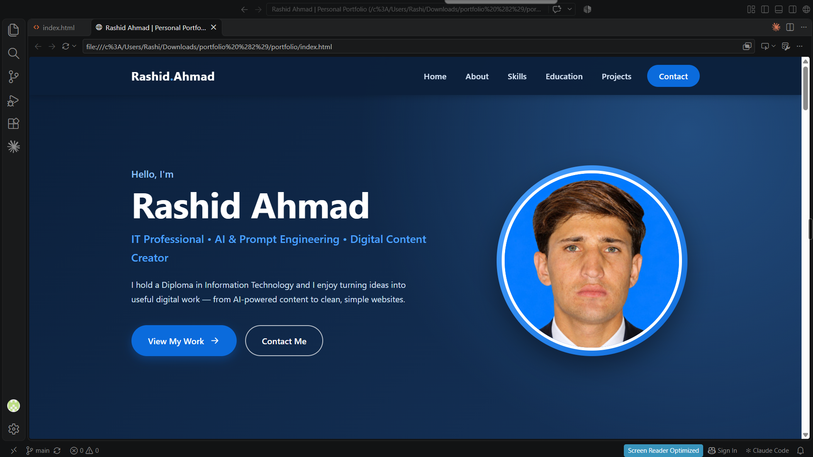
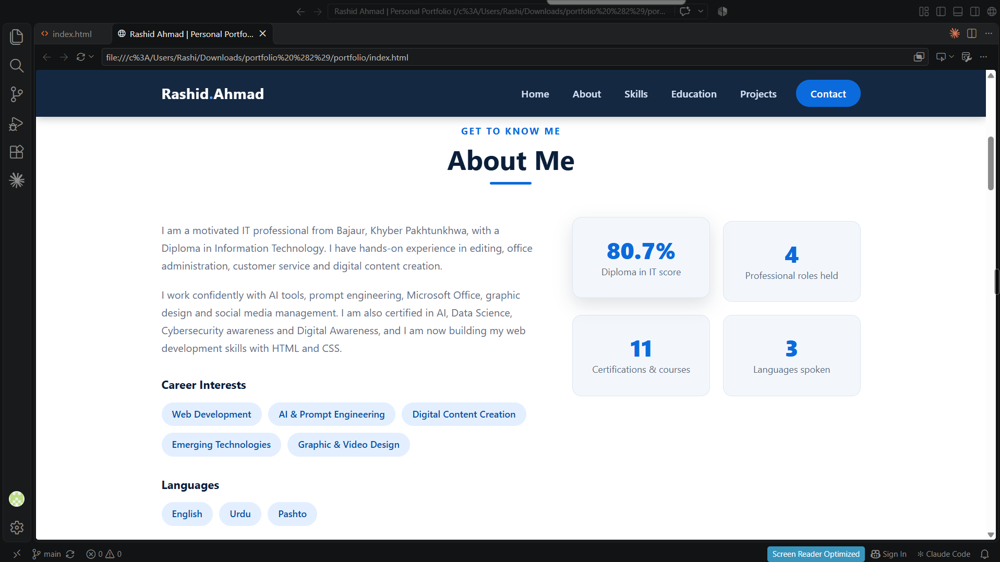
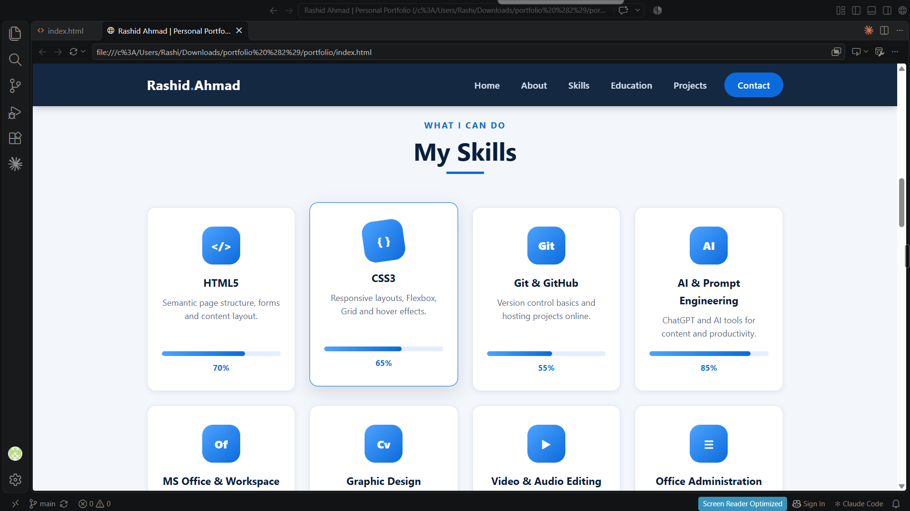
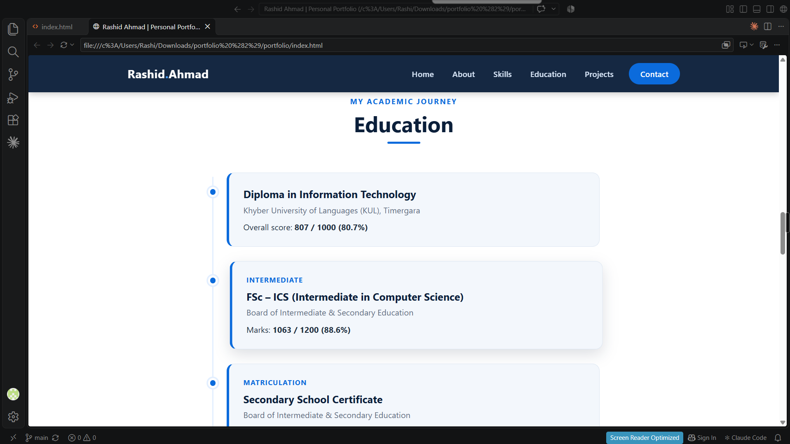
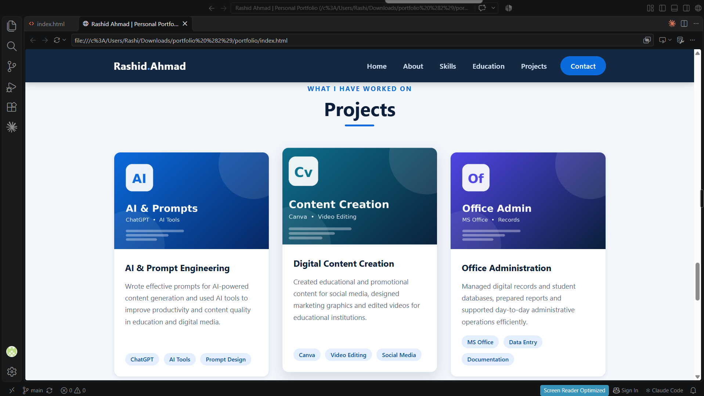
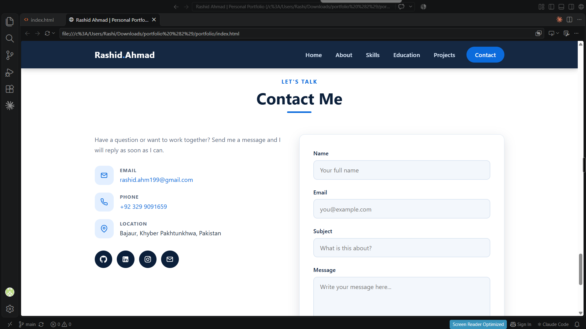
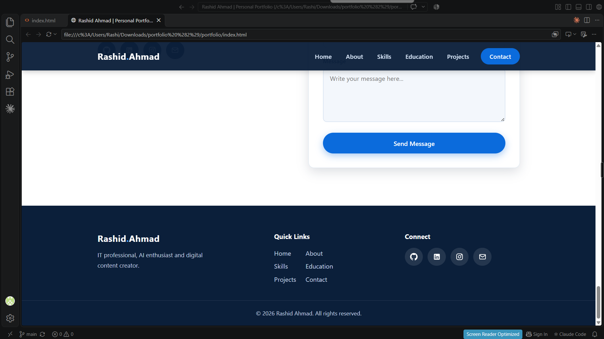
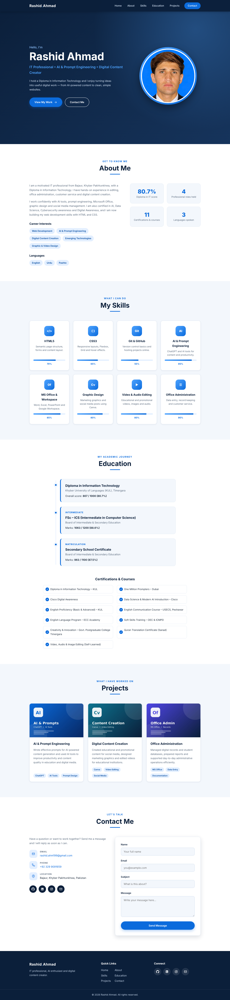
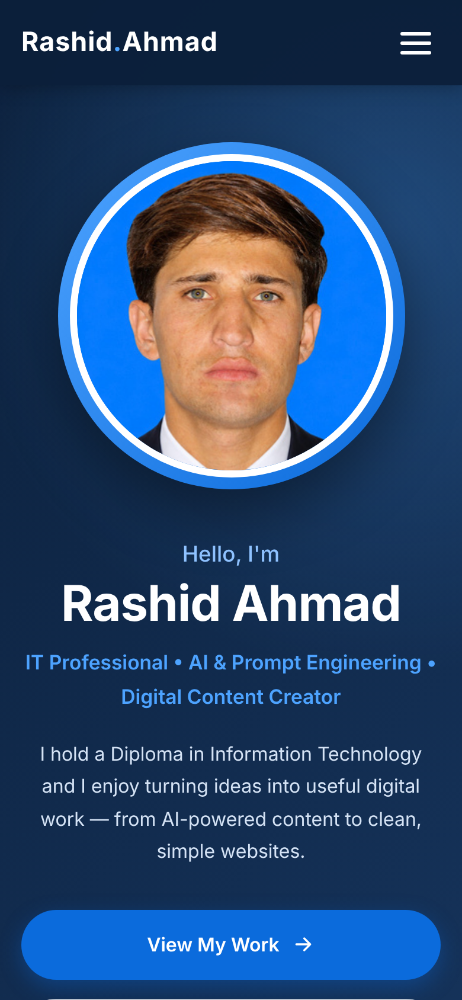

# Professional Personal Portfolio Website

**Devixo Solutions – Web Development Internship Program | Task 01**
**Author:** Rashid Ahmad

A modern, fully responsive personal portfolio website built from scratch with **HTML5 and CSS3 only**. No Bootstrap, no Tailwind, no templates, no JavaScript frameworks – every line of HTML and CSS is hand-written.

---

## Project Description

This website presents my profile, skills, education, projects and contact details in a clean and professional layout. It adapts to desktop, laptop, tablet and mobile screens without breaking the layout or causing horizontal scrolling.

## Technologies Used

| Technology | Purpose |
|------------|---------|
| **HTML5** | Semantic page structure (`header`, `nav`, `main`, `section`, `article`, `footer`) |
| **CSS3** | Styling, Flexbox, Grid, variables, animations, media queries |
| **Git & GitHub** | Version control and hosting the source code |

## Website Features

- ✅ **Sticky navigation bar** with working links to every section
- ✅ **Pure-CSS mobile menu** (hamburger button, no JavaScript needed)
- ✅ **Hero section** with name, tagline, short intro, profile photo and call-to-action buttons
- ✅ **About section** with introduction, career interests, languages and quick stats
- ✅ **Skill cards** with icons and progress bars
- ✅ **Education timeline** plus certifications list
- ✅ **Project cards** (3 projects) with image, description and technology tags
- ✅ **Contact section** with email, phone, location, social links and a contact form UI
- ✅ **Footer** with copyright, social links and quick navigation links
- ✅ **Smooth scrolling** between sections
- ✅ **Hover animations** on buttons, nav links, skill cards, project cards and social icons
- ✅ **Fully responsive** – desktop, laptop, tablet and mobile
- ✅ Consistent blue colour theme with good contrast and readable typography
- ✅ Respects the "reduced motion" setting of the visitor's device

## Project Structure

```
portfolio/
├── index.html          # Main web page
├── style.css           # All styling
├── images/
│   ├── profile.jpg     # Profile photo
│   ├── project1.jpg    # Project thumbnails
│   ├── project2.jpg
│   └── project3.jpg
├── screenshots/        # Website screenshots used in this README
├── report/             # Project report (PDF / Word)
└── README.md
```

## Screenshots

### Home / Hero Section


### About Section


### Skills Section


### Education Section


### Projects Section


### Contact Section


### Footer


### Full Page – Desktop View


### Mobile View



## How to Run the Website

**Option 1 – Open directly**
1. Download or clone this repository.
2. Open the `portfolio` folder.
3. Double-click `index.html`. It opens in your browser.

**Option 2 – VS Code Live Server**
1. Open the folder in VS Code.
2. Install the **Live Server** extension.
3. Right-click `index.html` → **Open with Live Server**.

**Option 3 – Clone with Git**
```bash
git clone https://github.com/rashid-ahmad199/portfolio.git
cd portfolio
```
Then open `index.html` in any browser.

## Contact

- 📧 rashid.ahm199@gmail.com
- 📍 Bajaur, Khyber Pakhtunkhwa, Pakistan

---

Made with ❤️ by **Rashid Ahmad** · Devixo Solutions Web Development Internship · Task 01
